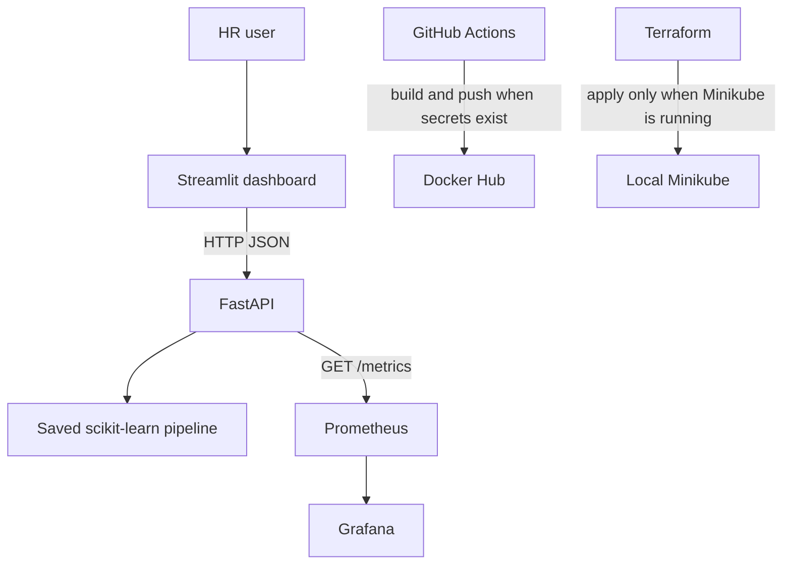

# Employee Attrition Prediction Using Machine Learning and End-to-End MLOps

## Project overview

This project predicts whether an employee is likely to leave, then serves that prediction through a small operations stack. A scikit-learn pipeline is trained on the IBM HR Analytics Employee Attrition dataset, saved with joblib, and called by a FastAPI service. A Streamlit dashboard sends employee records to that API. Prometheus scrapes the API, and Grafana charts those metrics. Docker, Kubernetes, Terraform, and GitHub Actions files are included so the same application can be packaged and deployed locally.

The dashboard does not load its own copy of the model. Scoring, holdout metrics, feature importance, and data-drift checks all come from the API.

## Problem statement

The dataset has many more employees who stayed than employees who left. A model that only maximizes accuracy can look strong while missing most of the people who leave. This project trains two classifiers, compares them on the minority class (Attrition = Yes), and saves the model with the better minority-class F1-score. Recall and ROC-AUC break ties. Accuracy is reported, but it is not the selection metric.

A probability from this model is an estimate, not a certainty. The classifiers use `class_weight="balanced"`, so the score is a relative risk estimate rather than a guaranteed frequency. The model does not identify causes.

## Dataset

Source: [IBM HR Analytics Employee Attrition & Performance](https://www.kaggle.com/datasets/pavansubhasht/ibm-hr-analytics-attrition-dataset) on Kaggle. The file was already downloaded and is stored at:

`data/WA_Fn-UseC_-HR-Employee-Attrition.csv`

The file has 1,470 rows and 35 columns. There are no missing values. The target column is `Attrition`:

| Class | Employees | Share |
| --- | ---: | ---: |
| No (stayed) | 1,233 | 83.88% |
| Yes (left) | 237 | 16.12% |

Columns removed before training:

- `EmployeeNumber` is an identifier.
- `EmployeeCount`, `Over18`, and `StandardHours` are constants.
- `DailyRate`, `HourlyRate`, and `MonthlyRate` are excluded so the saved pipeline matches the 27 fields on the prediction form.

The model uses the remaining 27 columns. Categorical fields are `BusinessTravel`, `Department`, `EducationField`, `Gender`, `JobRole`, `MaritalStatus`, and `OverTime`. The other 20 fields are treated as numbers, including the 1–5 and 1–4 survey codes already stored as integers in the file.

From the full dataset, employees who left had a lower monthly income (mean 4,787, median 3,202) than employees who stayed (mean 6,833, median 5,204). They also had fewer years at the company (mean 5.13, median 3) than employees who stayed (mean 7.37, median 6). These are descriptions of this file, not proof of cause.

## Machine learning methodology

Training is `python -m ml.train`. The same code path is used by the tests.

1. Load the CSV and check that the target and feature columns exist.
2. Record missing-value counts. This file has none. The saved pipeline still contains median imputation for numbers and most-frequent imputation for categories, so training and inference share one preprocessing path.
3. Scale numeric columns and one-hot encode categories inside a scikit-learn `Pipeline`. Unknown categories at inference are ignored.
4. Split the rows 80/20 with `random_state=42` and stratification on Attrition. The saved split is 1,176 training rows (190 left) and 294 test rows (47 left).
5. Fit logistic regression and a random forest. Both use `class_weight="balanced"` and `random_state=42`.
6. Score the untouched test rows with accuracy, precision, recall, F1, and ROC-AUC. Precision, recall, and F1 below are for Attrition = Yes.
7. Keep the model with the higher Attrition F1. Ties would go to Attrition recall, then ROC-AUC.
8. Save the fitted pipeline, the training-feature reference used for drift checks, and the evaluation JSON files.

The saved model is the pipeline fitted on the training split only. It is not refit on the full file, so `ml/metrics.json` describes that same object. A test reloads the pipeline, repeats the split, and checks that the stored ROC-AUC, F1, and accuracy match a fresh holdout calculation.

## Model comparison and evaluation results

These numbers were produced by `python -m ml.train` on this dataset. They are not hand-entered.

| Model | Accuracy | Precision (Yes) | Recall (Yes) | F1 (Yes) | ROC-AUC |
| --- | ---: | ---: | ---: | ---: | ---: |
| Logistic regression | 0.769 | 0.376 | 0.681 | 0.485 | 0.814 |
| Random forest | 0.837 | 0.474 | 0.191 | 0.273 | 0.803 |

Selected model: **logistic regression**.

The random forest has higher accuracy and a similar ROC-AUC, but at the default decision threshold it finds few of the employees who left (recall 0.191). Logistic regression finds more of them (recall 0.681) and has the higher Attrition F1 (0.485). That is why it is the saved model.

Holdout confusion matrix for logistic regression. Rows are actual class, columns are predicted class, in the order No, Yes:

|  | Predicted No | Predicted Yes |
| --- | ---: | ---: |
| Actual No | 194 | 53 |
| Actual Yes | 15 | 32 |

On the 247 employees who stayed, precision is 0.928, recall is 0.785, and F1 is 0.851. The classification report, both models, and the selection sentence are in `ml/metrics.json` and `ml/model_comparison.json`.

## Feature importance

Importance is global Random Forest impurity, summed from one-hot columns back to the original field. It is not a cause, and it is not an explanation of one employee. The saved scoring model is logistic regression. The importance display still comes from the fitted random forest, which is the tree model requested for this view.

| Rank | Feature | Importance |
| --- | --- | ---: |
| 1 | MonthlyIncome | 0.078 |
| 2 | Age | 0.072 |
| 3 | OverTime | 0.069 |
| 4 | TotalWorkingYears | 0.060 |
| 5 | JobRole | 0.054 |

The full list is in `ml/metrics.json`.

## System architecture



GitHub-hosted runners cannot reach a Minikube cluster on a developer's computer. The CD workflow skips cluster deployment unless a kubeconfig secret is configured, and even then it only targets a cluster that the runner can actually reach.

## Technology stack

- Machine learning: Python, pandas, NumPy, scikit-learn, SciPy, joblib
- API: FastAPI, Pydantic, Uvicorn
- Dashboard: Streamlit, Plotly
- Metrics: prometheus-client, Prometheus, Grafana
- Packaging: Docker Compose
- Cluster manifests: Kubernetes YAML for Minikube
- Infrastructure as code: Terraform Kubernetes provider
- CI/CD: GitHub Actions, Docker Hub
- Tests: pytest

Drift checks use pandas and SciPy rather than Evidently. The statistical checks are small, they run inside the API, and they avoid an extra heavy dependency.

## Project structure

```text
data/WA_Fn-UseC_-HR-Employee-Attrition.csv
ml/train.py
ml/features.py
ml/drift.py
ml/model.pkl
ml/metrics.json
ml/model_comparison.json
ml/reference_features.csv
ml/eda_summary.json
api/main.py
api/schemas.py
api/service.py
api/metrics.py
api/Dockerfile
streamlit_app/app.py
streamlit_app/Dockerfile
tests/
kubernetes/
terraform/
monitoring/prometheus.yml
monitoring/grafana/
.github/workflows/ci.yml
.github/workflows/cd.yml
docker-compose.yml
requirements.txt
```

`ml/features.py` is the column contract shared by training and the API. The Streamlit form uses the same 27 names.

## Prerequisites

Install these programs yourself. They are not Python packages in `requirements.txt`.

| Tool | Required for |
| --- | --- |
| Python 3.11 | Training, the API, the dashboard, and tests |
| Git | Version control and GitHub |
| Docker Desktop | Images, Compose, Prometheus, Grafana, and cAdvisor |
| Minikube and kubectl | The Kubernetes deployment path |
| Terraform 1.5 or newer | The Terraform deployment path |
| Docker Hub account | The CD workflow that pushes images |

Python 3.11 matches the Docker images and GitHub Actions. Docker, Minikube, kubectl, and Terraform are separate installers. The cluster and container steps do nothing until those programs are installed and running.

## Project dependencies

`requirements.txt` is the Python dependency list: pandas, NumPy, scikit-learn, FastAPI, Streamlit, Prometheus client, and the test tools. Install them into a virtual environment:

```powershell
py -3.11 -m venv .venv
.\.venv\Scripts\Activate.ps1
python -m pip install --upgrade pip
pip install -r requirements.txt
```

Do not commit `.venv/`. Create it on each machine.

## Model training

From the project root:

```powershell
python -m ml.train
```

This writes:

- `ml/model.pkl`
- `ml/metrics.json`
- `ml/model_comparison.json`
- `ml/reference_features.csv`
- `ml/eda_summary.json`

## FastAPI

```powershell
uvicorn api.main:app --host 127.0.0.1 --port 8000
```

- Swagger UI: http://127.0.0.1:8000/docs
- Health: `GET /health` returns `model_available: true` when `ml/model.pkl` loads
- One employee: `POST /predict`
- Many employees: `POST /predict/batch` with `{"employees": [ ... ]}`
- Prometheus text: `GET /metrics`
- Dataset summary: `GET /analytics/overview`
- Saved evaluation: `GET /model/performance`
- Drift check: `POST /drift/check`

Risk categories use the attrition probability from the model: Low below 0.35, Medium from 0.35 up to 0.60, and High at 0.60 or above.

If port 8000 is already in use, start Uvicorn on another port and point Streamlit at that same URL.

## Streamlit

In a second terminal, with the API already running:

```powershell
$env:API_BASE_URL = "http://127.0.0.1:8000"
streamlit run streamlit_app/app.py
```

Open http://127.0.0.1:8501. The sidebar has Overview, Employee prediction, Batch prediction, Model performance, and Data drift. If the API is on another port, change **API base URL** in the sidebar.

The prediction page shows Attrition Yes or No, both probabilities, a risk category, the top five global features, and general HR follow-up topics. Those topics are conversation prompts. They are not causes identified by the model.

Batch prediction accepts a CSV with the model columns, ignores an `Attrition` column if one is present, shows the scored table, and offers a CSV download.

## Docker

Install and start Docker Desktop before these commands. Image builds are not part of `pytest`.

```powershell
docker compose build
docker compose up -d
docker compose ps
docker compose logs -f
docker compose down
```

- API: http://localhost:8000
- Streamlit: http://localhost:8501
- Prometheus: http://localhost:9090
- Grafana: http://localhost:3000

Inside Compose, Streamlit calls `http://api:8000`. Grafana's local demo login is `admin` / `admin`. Anonymous view is also enabled so the dashboard can be opened directly. Change that password before using the stack on a shared machine.

Compose also starts cAdvisor and Prometheus scrapes it at `cadvisor:8080`. The Grafana panels named "Container CPU (cAdvisor)" and "Container memory (cAdvisor)" use `container_cpu_usage_seconds_total` and `container_memory_usage_bytes`. Those series exist only after that container is running. They are not Kubernetes node metrics, and the Minikube manifests do not deploy cAdvisor.

Build one image at a time:

```powershell
docker build -f api/Dockerfile -t employee-attrition-api:local .
docker build -f streamlit_app/Dockerfile -t employee-attrition-streamlit:local .
```

Train the model before building the API image. The image copies `ml/model.pkl` and the dataset.

## GitHub and GitHub Actions

Run these commands yourself when you want a repository. Do not push until you intend to publish the project.

```powershell
git init
git checkout -b main
git add .
git commit -m "Add employee attrition prediction and local MLOps stack"
git branch dev
git checkout -b feature/attrition-dashboard
git push -u origin main
git tag -a v1.0.0 -m "Release v1.0.0"
git push origin v1.0.0
```

Create an empty GitHub repository first, add it as `origin`, and push only when you want the code on GitHub. Do not commit `.env` files, cloud keys, or `ml/drift_report.json`. The model file is small and should be committed so a fresh clone can score without retraining. CI also retrains before it builds images.

Workflows:

- `.github/workflows/ci.yml` runs on every push and pull request. It installs dependencies, trains the pipeline, runs pytest, runs the API tests, and builds both Docker images.
- `.github/workflows/cd.yml` runs on pushes to `main` and on tags that match the glob `v*`. Before it publishes a tag, it checks that the tag is a semantic version `vMAJOR.MINOR.PATCH`, such as `v1.0.0`. A tag such as `vlatest` starts the workflow and then fails that check. Main-branch pushes are tagged `main-<short sha>` and `latest`. The Docker Hub push and the optional cluster deploy are unchanged.

## Docker Hub secrets

In the GitHub repository, open Settings, then Secrets and variables, then Actions, and create:

- `DOCKERHUB_USERNAME`: your Docker Hub username
- `DOCKERHUB_TOKEN`: a Docker Hub access token, not your account password

Create the token in Docker Hub under Account Settings, then Personal access tokens. The CD job fails with a clear message if the username secret is empty.

Optional secret `KUBE_CONFIG` is the base64 form of a kubeconfig for a cluster the GitHub runner can reach. It is not used for local Minikube. Encode it only if you have a reachable cluster:

```powershell
[Convert]::ToBase64String([IO.File]::ReadAllBytes("$env:USERPROFILE\.kube\config"))
```

## Choose one deployment path

Kubernetes manifests and Terraform create the same namespace, API deployment, API service, Streamlit deployment, and Streamlit service. Use one path for those five objects.

- **kubectl path.** Apply the files in `kubernetes/`. This path does not keep Terraform state.
- **Terraform path.** Run Terraform in `terraform/`. Terraform stores state and will try to correct anything else that changes those same objects.

Applying both causes the next `terraform plan` to report drift. Monitoring and the optional autoscaler are kubectl-only. If you use Terraform for the application, still apply `kubernetes/monitoring.yaml` and, after the dashboard ConfigMap below, restart Grafana. Do not put those monitoring objects in Terraform.

GitHub Actions cannot deploy to a Minikube cluster on your computer. The CD job deploys only when the `KUBE_CONFIG` secret points at a cluster that the GitHub runner can reach.

## Kubernetes

Install Docker Desktop, Minikube, and kubectl before these commands. No pods are created by the test suite.

```powershell
winget install -e --id Docker.DockerDesktop
winget install -e --id Kubernetes.minikube
winget install -e --id Kubernetes.kubectl
```

Restart the terminal after installation. Start Docker Desktop, then:

```powershell
minikube start --driver=docker
minikube status
docker build -f api/Dockerfile -t employee-attrition-api:local .
docker build -f streamlit_app/Dockerfile -t employee-attrition-streamlit:local .
minikube image load employee-attrition-api:local
minikube image load employee-attrition-streamlit:local
kubectl apply -f kubernetes/namespace.yaml
kubectl apply -f kubernetes/api-deployment.yaml
kubectl apply -f kubernetes/api-service.yaml
kubectl apply -f kubernetes/streamlit-deployment.yaml
kubectl apply -f kubernetes/streamlit-service.yaml
kubectl get pods -n employee-attrition
kubectl get deployments -n employee-attrition
kubectl get services -n employee-attrition
kubectl logs -n employee-attrition deploy/attrition-api
kubectl scale deployment/attrition-api -n employee-attrition --replicas=2
kubectl rollout restart deployment/attrition-api -n employee-attrition
kubectl port-forward -n employee-attrition svc/attrition-streamlit 8501:8501
```

The Streamlit pod calls the API at `http://attrition-api:8000`. Each deployment requests CPU and memory, sets limits, and has readiness and liveness probes. The API service is ClusterIP. The Streamlit service is NodePort.

Use either kubectl or Terraform for the application resources, not both. They manage the same names.

The Horizontal Pod Autoscaler is optional and is not applied by the commands above. Enable metrics-server first:

```powershell
minikube addons enable metrics-server
kubectl top pods -n employee-attrition
kubectl apply -f kubernetes/hpa.yaml
```

If `kubectl top` fails, skip the autoscaler. The application does not depend on it.

## Terraform

Install Terraform, start Minikube, and load the local images before `terraform apply`. Apply creates resources only when the kubeconfig exists and the context can reach the cluster. `terraform validate` checks the files. It does not create pods.

```powershell
winget install -e --id Hashicorp.Terraform
minikube start --driver=docker
minikube image load employee-attrition-api:local
minikube image load employee-attrition-streamlit:local
cd terraform
terraform init
terraform validate
terraform plan
terraform apply
terraform destroy
```

If `kubectl config current-context` is not `minikube`, pass the real context:

```powershell
terraform plan -var "kube_context=minikube"
```

Do not `kubectl apply` the application manifests if Terraform is managing them. Monitoring files under `kubernetes/monitoring.yaml` and `kubernetes/hpa.yaml` are kubectl-only.

## Prometheus

`monitoring/prometheus.yml` is mounted by Docker Compose. It scrapes `api:8000/metrics` every 5 seconds under the job name `attrition-api`. `monitoring/prometheus-k8s.yml` uses the same job name and scrapes `attrition-api.employee-attrition.svc.cluster.local:8000`, so the Grafana queries work in either network.

The API exports:

- `http_requests_total`
- `prediction_requests_total` (employee rows scored, including each row in a batch)
- `attrition_predictions_total`
- `retention_predictions_total`
- `http_request_duration_seconds`
- `failed_requests_total`
- `model_available`
- `process_cpu_seconds_total`
- `process_resident_memory_bytes`

On Linux the process series come from `/proc`. On Windows the API fills the same names because `/proc` is absent. A Prometheus server scrape is separate from the API exposing `/metrics`, and it requires Docker Compose or the Minikube monitoring deployment.

For Minikube, after the API is running:

```powershell
kubectl apply -f kubernetes/monitoring.yaml
kubectl -n employee-attrition create configmap grafana-dashboard --from-file=attrition.json=monitoring/grafana/dashboards/attrition.json --dry-run=client -o yaml | kubectl apply -f -
kubectl -n employee-attrition rollout restart deployment/grafana
kubectl port-forward -n employee-attrition svc/prometheus 9090:9090
```

The ConfigMap command is required. Grafana's dashboard volume is optional until that ConfigMap exists, so the dashboard JSON is not loaded by `kubectl apply -f kubernetes/monitoring.yaml` alone. Restart Grafana after creating or updating the ConfigMap.

Open http://localhost:9090/targets and confirm that `attrition-api` is UP before treating the scrape as successful. The Kubernetes Prometheus config does not scrape cAdvisor.

## Grafana

Provisioning files:

- `monitoring/grafana/provisioning/datasources/datasource.yml` points at `http://prometheus:9090` with datasource uid `prometheus`
- `monitoring/grafana/provisioning/dashboards/dashboards.yml` loads JSON from `/var/lib/grafana/dashboards`
- `monitoring/grafana/dashboards/attrition.json` is the Employee Attrition Intelligence dashboard

Panels and PromQL:

1. Total prediction requests: `sum(prediction_requests_total)`
2. Attrition predictions: `sum(attrition_predictions_total)`
3. Retention predictions: `sum(retention_predictions_total)`
4. Prediction request rate: `sum(rate(prediction_requests_total[5m]))`
5. Average API latency: `sum(rate(http_request_duration_seconds_sum[5m])) / sum(rate(http_request_duration_seconds_count[5m]))`
6. API errors: `sum(rate(failed_requests_total[5m]))`
7. Application availability: `model_available`
8. API process CPU: `rate(process_cpu_seconds_total{job="attrition-api"}[5m])`
9. API process resident memory: `process_resident_memory_bytes{job="attrition-api"}`
10. Container CPU, Docker Compose cAdvisor only: `sum by (name) (rate(container_cpu_usage_seconds_total{job="cadvisor",image!=""}[5m]))`
11. Container memory, Docker Compose cAdvisor only: `sum by (name) (container_memory_usage_bytes{job="cadvisor",image!=""})`

Panels 8 and 9 describe the API process. Panels 10 and 11 describe containers only when the Compose cAdvisor target is scraped. They are not Kubernetes infrastructure charts.

With Docker Compose, open http://localhost:3000. The dashboard is in the Employee Attrition folder. Login `admin` / `admin` if you need to edit. Rate panels need a minute of scrapes and some API traffic before they draw a line.

On Minikube, create the dashboard ConfigMap, restart Grafana, and then port-forward:

```powershell
kubectl port-forward -n employee-attrition svc/grafana 3000:3000
```

## Data drift monitoring

Data drift means the incoming feature values have a different distribution from the training rows saved in `ml/reference_features.csv`. Model performance degradation means the predictions became less accurate. The drift report only describes input distributions. It does not report accuracy, and it cannot show performance degradation. Measuring that requires ground-truth attrition labels.

A check needs at least 30 complete rows. Numeric columns use a Kolmogorov-Smirnov test plus a standardized mean shift. Categorical columns use total variation distance and a chi-square test. The API returns `no_drift`, `warning`, `drift_detected`, or `insufficient_data`, plus the disclaimer above.

In the dashboard, open Data drift and upload a CSV, or score a batch first and reuse those rows. `GET /drift/latest` returns the last report.

## Testing

```powershell
pytest
```

The tests cover dataset loading, the stratified split, minority-class model selection, holdout metrics recomputed from `ml/model.pkl`, probabilities, feature importance, drift detection, health, single and batch prediction, a CSV-shaped batch, CSV rejection cases, Prometheus names, overview totals, and the dashboard field list. They also check that the Grafana queries use the exported metric names and the cAdvisor metric names. Passing tests do not build images or contact a cluster.

## What to leave out of Git and zip archives

`.gitignore` and `.gitattributes` exclude `.venv/`, `.pytest_cache/`, `.terraform/`, and `ml/drift_report.json`. `git archive` also omits them. Keep `ml/model.pkl`, `data/WA_Fn-UseC_-HR-Employee-Attrition.csv`, the source files, and `terraform/.terraform.lock.hcl`.

## Verified functionality and pending deployment

These behaviors are covered by the automated tests and by running the API and Streamlit locally with Python:

- The saved pipeline scores employees and the holdout metrics match that pipeline.
- FastAPI health, single prediction, batch prediction, metrics, overview, and drift endpoints respond from the application code.
- The Streamlit form, batch CSV checks, and download button call that API.

These steps stay pending until the named program is installed and you run the command:

- `docker compose build` and both image builds, until Docker Desktop is running.
- Minikube pods, until Minikube and kubectl are installed and the manifests are applied.
- `terraform apply`, until Terraform can read a kubeconfig for a running cluster. `terraform validate` only checks the configuration.
- A Prometheus target showing UP, until Prometheus is started and can reach the API.
- The Grafana UI, until Grafana is started. On Minikube, the dashboard also needs the ConfigMap command and a Grafana restart.

## Troubleshooting

- **Port 8000 is already in use.** Start the API on another port, for example `--port 8010`, and set `API_BASE_URL` to that same address before starting Streamlit. The sidebar can point at the same URL.
- **The dashboard says the API is not connected.** Start Uvicorn first. The default URL is `http://127.0.0.1:8000`.
- **`/health` returns 503.** Run `python -m ml.train` from the project root so `ml/model.pkl` exists.
- **Docker is not recognized.** Install Docker Desktop, start it, and open a new terminal. `docker compose` is the v2 command.
- **Minikube pods stay at ImagePullBackOff.** Build the `:local` images and run `minikube image load` for both. The manifests use `imagePullPolicy: IfNotPresent`.
- **Terraform cannot read the kubeconfig.** Start Minikube before `terraform plan` or `terraform apply`. The expected file is `%USERPROFILE%\.kube\config`.
- **Applying kubectl and Terraform both.** Pick one. Applying both makes the next plan show drift on the same Deployments and Services.
- **GitHub Actions did not deploy to Minikube.** That is expected. Run the Minikube commands on a machine that has the cluster.
- **Grafana panels are empty.** Generate a few predictions, wait for two or more Prometheus scrapes, and set the time range to the last 15 minutes.
- **A high probability does not mean the employee will leave.** The score is a model estimate from a class-weighted classifier. Use it as a prompt for an HR conversation, not as a decision by itself.
